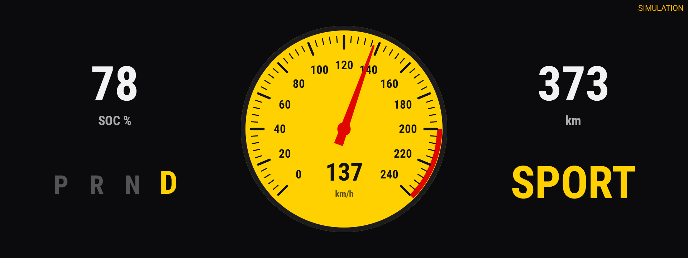
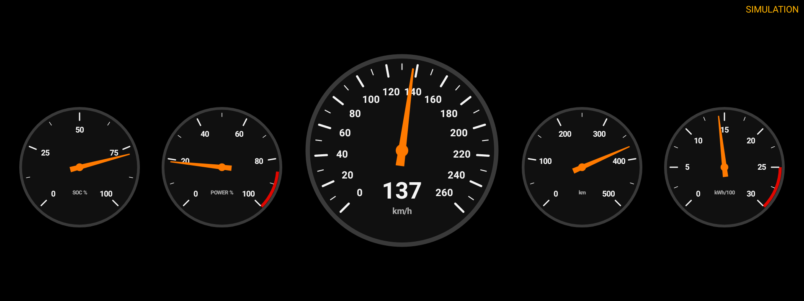
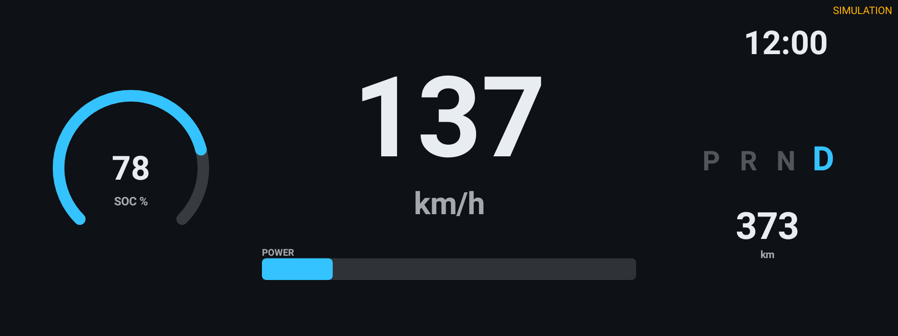
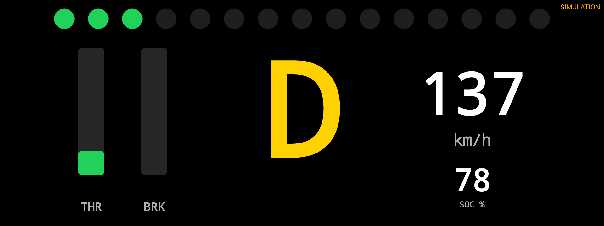
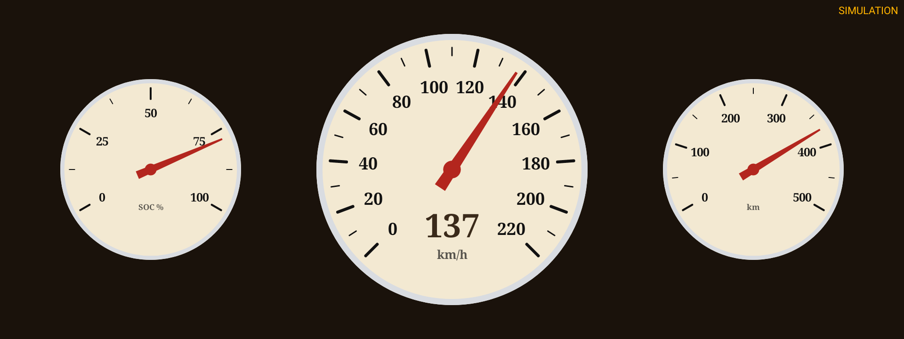
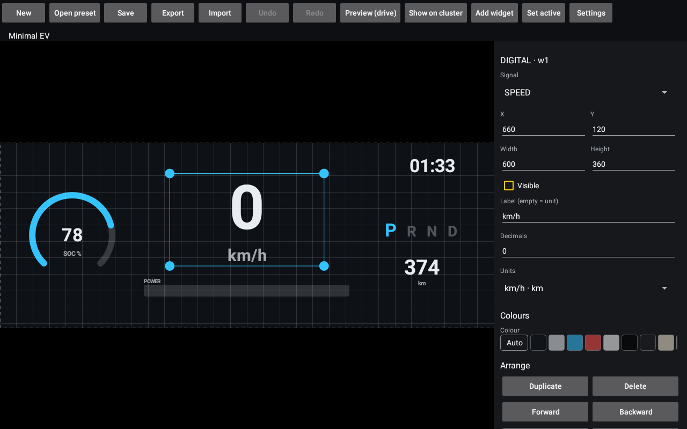

# Gauges — edytor i wyświetlacz własnych zegarów

Osobna aplikacja (moduł `:gauges`) dla BYD DiLink 3 (Android 10, API 29): pełnoekranowy dashboard
z wskaźnikami zasilanymi danymi z auta, edytor układów i 5 gotowych presetów. Bydlak Dash wyświetla
ją na ekranie zegarów (1920×720) jak każdą inną aplikację. Specyfikacja:
[docs/specs/gauges-editor.md](../docs/specs/gauges-editor.md).

| Sport Tach | Classic Five |
|---|---|
|  |  |
| **Minimal EV** | **Racing** |
|  |  |
| **Retro Analog** | **Brak danych z auta** (wszystko `UNAVAILABLE`) |
|  |  |

Edytor: 

Zrzuty są wyrenderowane w Robolectric (natywna grafika, dane z symulacji), nie z auta ani emulatora.

## Budowanie

Wymagania: JDK 17 (toolchain Gradle i tak wymusza 17), Android SDK z `platforms;android-33`
i `build-tools;35.0.0`, `local.properties` z `sdk.dir=...`.

```sh
./gradlew :gauges:testDebugUnitTest :gauges:assembleDebug
```

APK: `gauges/build/outputs/apk/debug/BydlakGauges-v<wersja>-debug.apk`.

Podpis działa jak w `:app`: jeśli istnieje `app/keystore/platform.keystore`, APK jest podpisany
platformowo; jeśli nie — kluczem debug (release dostaje wtedy sufiks `-debugsigned`). **Bez podpisu
platformowego API BYD są odrzucane** — aplikacja działa, ale wszystkie sygnały z auta są `UNAVAILABLE`
(szare „--”), a sensowny obraz daje tylko tryb symulacji.

Identyfikator pakietu jest wyprowadzany z `forkApplicationId` w `app/build.gradle` z sufiksem
`.gauges` — obecnie `pl.mwalkowiak.bydlakdash.gauges`.

## Instalacja

```sh
adb connect <ip-auta>:5555          # albo USB
adb install -r gauges/build/outputs/apk/debug/BydlakGauges-v0.1.0-debug.apk
```

Pojawią się dwie ikony: **Gauges** (dashboard) i **Gauges editor**.

## Wybór w Bydlak Dash

1. W edytorze wybierz preset albo zbuduj układ i naciśnij **Ustaw aktywny**.
2. W Bydlak Dash wybierz na liście aplikacji dla zegarów **Gauges**
   (`pl.mwalkowiak.bydlakdash.gauges`).

Bydlak Dash uruchamia aplikację przez `getLaunchIntentForPackage`, a `DashboardActivity` ma
`CATEGORY_INFO`, więc zawsze startuje dashboard, nie edytor. Projekcję robi wyłącznie Bydlak Dash;
przycisk „Pokaż na zegarach” w edytorze tylko to wyjaśnia i otwiera Bydlak Dash. Dashboard sam
przeładowuje się po zmianie aktywnego układu, symulacji albo trybu nocnego.

Na ekranie głównym długie przytrzymanie dashboardu otwiera edytor.

## Symulacja i tryb nocny

Edytor → **Ustawienia**: „Symulacja” (domyślnie włączona tam, gdzie nie ma klas `bydauto` —
emulator, telefon; wyłączona w aucie), „Tryb nocny” i poziom przyciemnienia (maks. 80 %, żeby nigdy
nie wygasić prędkości). Dane symulowane są zawsze oznaczone napisem **SIMULATION / SYMULACJA**.

## Reguły układu

- Układ musi mieć co najmniej jeden **widoczny** widget z sygnałem `SPEED` typu DIAL, ARC, BAR lub
  DIGITAL, o rozmiarze ≥ 160×80 px. Edytor nie zapisze (ani nie wyeksportuje) układu bez tego
  i wyświetla komunikat z powodem.
- Żaden widget nie może wychodzić poza płótno.
- Aktywny układ jest walidowany ponownie przy starcie dashboardu; plik nieczytelny lub niespełniający
  reguł → dashboard pokazuje preset „Minimal EV”.
- Wartość, która nie jest aktualna (`STALE` po 2 s bez aktualizacji dla `SPEED`, 30 s dla reszty;
  `UNAVAILABLE`, `INVALID`), jest rysowana na szaro jako „--”, nigdy jako stara liczba.

## Do zweryfikowania w aucie

Nic z poniższego nie było jeszcze sprawdzone na samochodzie — kod opiera się wyłącznie na stubach
z `app/libs/byd-auto-api-stubs.jar`.

### Nazwy uprawnień

`BYDAUTO_STATISTIC_COMMON/GET` i `BYDAUTO_CHARGING_COMMON/GET` są dopisane według wzorca pozostałych,
ale ich nazwy **nie są potwierdzone** (żaden kod w repo dotąd nie używał tych urządzeń). Sprawdź:

```sh
adb shell pm list permissions | grep BYDAUTO
adb shell dumpsys package pl.mwalkowiak.bydlakdash.gauges | grep -A40 "requested permissions"
```

Błędna nazwa jest przy instalacji po cichu ignorowana — wtedy SOC, zasięgi, przebieg, zużycie
i ładowanie będą `UNAVAILABLE`.

### Sygnały (sekcja 4.1 specyfikacji)

Dla każdego sprawdź, czy wartość się pojawia, ma sensowną skalę i zmienia się w czasie
(zarówno odczyt getterem przy starcie, jak i listener):

| Sygnał | Źródło | Na co zwrócić uwagę |
|---|---|---|
| SPEED | `BYDAutoSpeedDevice.getCurrentSpeed()` / `onSpeedChanged` | czy przy stałej prędkości nie przechodzi w STALE (getter odpytywany co 500 ms) |
| ACCEL_PEDAL | `getAccelerateDeepness()` | zakres 0–100 |
| BRAKE_PEDAL | `getBrakeDeepness()` | zakres 0–100 |
| BATTERY_SOC | `BYDAutoStatisticDevice.getElecPercentageValue()` | uprawnienie STATISTIC |
| EV_RANGE | `getElecDrivingRangeValue()` | stub ogranicza do 0–511 km |
| FUEL_PERCENT | `getFuelPercentageValue()` | tylko DM-i |
| FUEL_RANGE | `getFuelDrivingRangeValue()` | tylko DM-i |
| ODOMETER | `getTotalMileageValue()` | |
| CONSUMPTION_ELEC | `getLastElecConPHMValue()` | znak przy rekuperacji (stub dopuszcza −99,9…99,9) |
| DRIVING_TIME | `getDrivingTimeValue()` | jednostka (h?) |
| GEAR | `BYDAutoGearboxDevice.getGearboxAutoModeType()` | mapowanie `GEARBOX_AUTO_MODE_P/R/N/D/S/M` |
| PARK_BRAKE | `getParkBrakeSwitch()` | **założenie:** `SWITCH_VALID` = zaciągnięty, `SWITCH_INVALID` = zwolniony |
| CHARGING_POWER | `BYDAutoChargingDevice.getChargingPower()` | uprawnienie CHARGING; znak przy V2L |
| CHARGER_STATE | `getChargerState()` + `getChargingGunState()` | złącze (AC/DC/V2L) ma pierwszeństwo przed „podłączony” |
| DRIVE_MODE | `BYDAutoEnergyDevice.getOperationMode()` | ECO/SPORT |
| ENERGY_MODE | `getEnergyMode()` | EV/HEV/… |
| ENGINE_RPM | `BYDAutoEngineDevice.getEngineSpeed()` | tylko DM-i; na EV spodziewane `INVALID` |
| TIME | zegar systemowy | |

Wartości spoza zakresów `*_MIN/*_MAX` ze stubów (w tym kody `*_COMMAND_FAILED`) są oznaczane jako
`INVALID`. Logi: `adb logcat -s GaugesBydSource` pokazuje, które urządzenie jest niedostępne i dlaczego.

## Ograniczenia tego etapu

- Brak sygnału mocy/rekuperacji w tabeli 4.1 — presety używają `ACCEL_PEDAL` jako przybliżenia
  „mocy” (Classic Five, Minimal EV) i do sterowania SHIFT_LIGHTS na EV (Racing).
- `NAV_ARROW` jest tylko typem-zaślepką (niedostępnym w edytorze) z interfejsem `NavDataSource`.
- Czerwone pole tarczy działa „od wartości do końca skali”; strefy dolne (np. niski SOC) nie są
  obsługiwane.

## Testy

`./gradlew :gauges:testDebugUnitTest` — JUnit + Robolectric (API 29). Testują zachowanie: JSON
(round-trip, nieznane/brakujące pola, przycinanie), walidator i wszystkie presety z assets, kąty
wskazówki i tłumienie bez przestrzelenia, deterministyczność i zakresy symulacji, logikę `STALE`
na sterowanym zegarze, przyciąganie i cofnij/ponów edytora, `BydVehicleDataSource` bez klas `bydauto`
(→ `UNAVAILABLE` bez wyjątku) oraz start obu aktywności z każdym presetem.

W testach stuby są tylko `testCompileOnly`, więc w runtime nie ma klas `bydauto` — tak jak na
emulatorze. Testy aktywności pauzują `Choreographer` (`ShadowChoreographer.setPaused(true)`), bo pompa
klatek dashboardu re-postuje się co vsync, a zatrzymany looper Robolectric nie przesuwa czasu.
